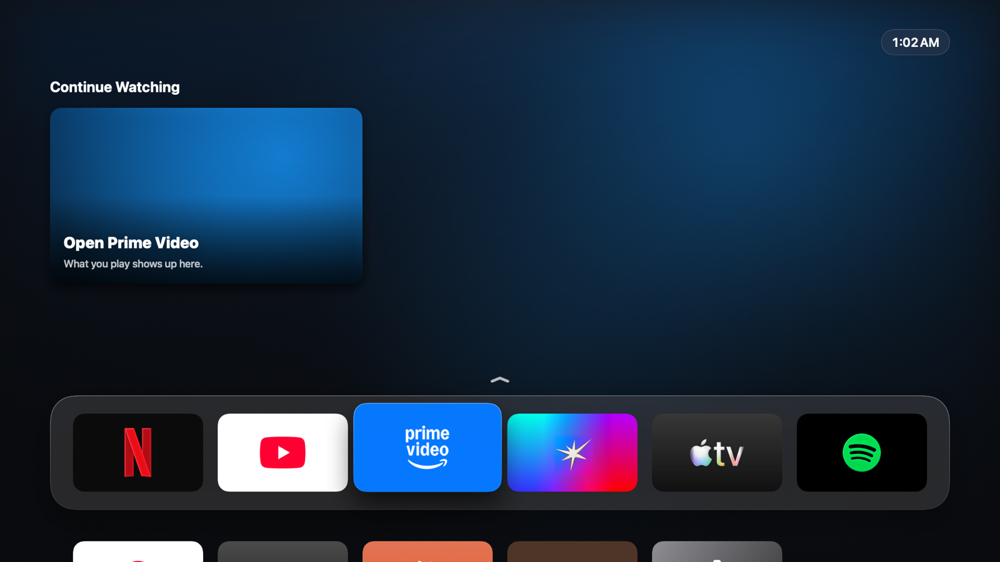

<p align="center"></p>

<h1 align="center">Mac TV</h1>

<p align="center">Turn a Mac into an Apple TV-style box: a tvOS-style home screen, your streaming apps at full quality, and your phone as the remote.</p>


## Screenshots

| Top Shelf | App grid |
|---|---|
|  |  |
| **Row Top Shelf (Prime Video)** | **Screensaver** |
|  |  |

| Phone remote | Apps | TV controls |
|---|---|---|
|  |  |  |

## Install

1. Download `MacTV-<version>.dmg` from [Releases](../../releases), open it, and drag **Mac TV** to Applications.
2. The first time you open it, macOS says it can't check the app, because it isn't notarized by Apple. Open **System Settings › Privacy & Security**, scroll down and click **Open Anyway**.
3. When macOS asks whether Mac TV may accept incoming network connections, choose **Allow**. Without it, phones can't reach the remote.

Requires macOS 14 or later.

## How it works

Mac TV is a native Mac app. Each streaming service runs in its official web player inside Apple's Safari engine (WebKit), so it gets FairPlay DRM, the same playback quality as Safari, up to 4K on Netflix. It isn't Android TV and doesn't emulate anything.

- **Home screen:** Apple TV's layout. A Top Shelf fills the screen behind a frosted glass dock of app tiles, with the next row peeking below. Move up to expand the Top Shelf (Resume, Open) and down for the full app grid. It fills any screen shape edge to edge.
- **Window:** opens as a normal window on your external display and remembers its place. Use the green button or ⌃⌘F for full screen.
- **Keyboard and trackpad:** arrows, Return and Escape. Scroll to move between the dock and the grid. ⌘⇧H goes home.
- **Websites built for a mouse:** a focus ring slides between links and buttons, so the D-pad works everywhere.

## Phone remote

Open **Settings** on the TV and scan the QR code with your phone's camera. No app to install: it's a web page the Mac serves to your phone. Add it to your home screen to keep it one tap away.

- **Clickpad:** swipe or tap the edges; hold to repeat; tap the middle for OK.
- **Touchpad:** drag the pointer, tap to click, two fingers to scroll.
- **Keys:** media keys, volume, and typing on the TV.
- **Haptics:** light haptic feedback on every press.
- **Tailscale:** the Tailscale QR code works away from home, or when your Wi-Fi keeps devices apart.

## Watching

- **Skip intros and recaps, play next episode:** Mac TV presses the players' own Skip Intro, Skip Recap and Next Episode buttons. It never presses an ad's "Skip" button. Turn these off in **TV controls** on the remote.
- **Sleep timer:** 15, 30, 60 or 90 minutes. When it ends, playback stops, Mac TV goes home and the screen turns off.
- **Screensaver:** after 5 idle minutes, a lock-screen-style clock appears over Apple's aerial films, if the Mac has downloaded them in System Settings › Wallpaper or Screen Saver. Otherwise it shows drifting colour.
- **Privacy:** the home screen never shows pictures of what you watched.

## Your apps

The built-in apps are Netflix, YouTube, Prime Video, JioHotstar, Apple TV, Spotify, YouTube Music and IINA (if it's installed).

On the phone remote, open **Apps**:
- **Add app → Website:** type an address. Mac TV finds the app's official icon itself and turns it into a tile that matches the rest.
- **Add app → Mac app:** pick any app installed on the Mac.
- **Edit:** removes apps. Removed built-in apps can be restored.

Tiles are generated automatically from any square app icon (`TileArt.swift`). Mac TV reads the icon's background, finds the logo, sizes it to a standard visual weight, and extends the background to the 5:3 tile.

## Build from source

```bash
./build.sh                  # builds "build/Mac TV.app"
open "build/Mac TV.app"
./scripts/make-dmg.sh       # builds build/MacTV-<version>.dmg
swift scripts/make-icon.swift   # redraws Assets/AppIcon.png and .icns
```

These checks run on their own and don't need the app open, unless noted:
- `MacTV --selftest-drm` prints the DRM systems available.
- `--export-tiles <folder>` renders the dock tiles, `--export-home <folder>` the home screen, and `--export-remote <file.png> [apps|controls]` the phone remote. The remote export needs Mac TV running.

Sign-ins, added apps and history are kept in `~/Library/Application Support/Mac TV`.

## Notes

- "Mac" is an Apple trademark. This is a personal project, not affiliated with Apple, Netflix, Google, Amazon, JioStar or Spotify. App icons belong to their owners.
