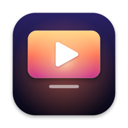
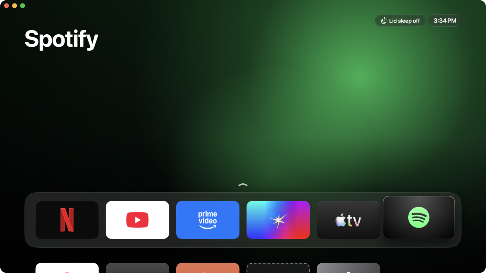
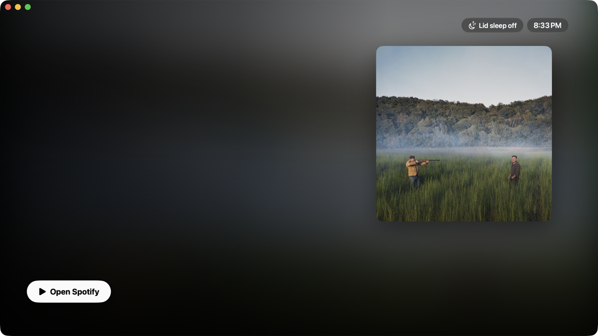
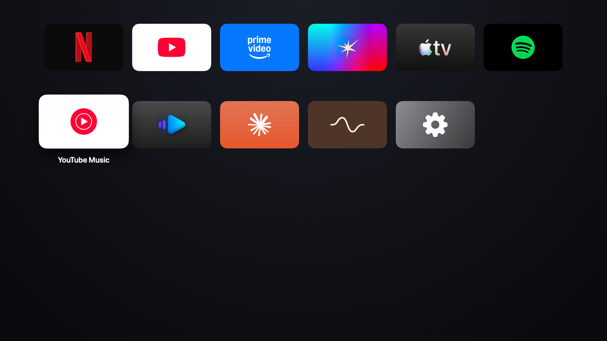
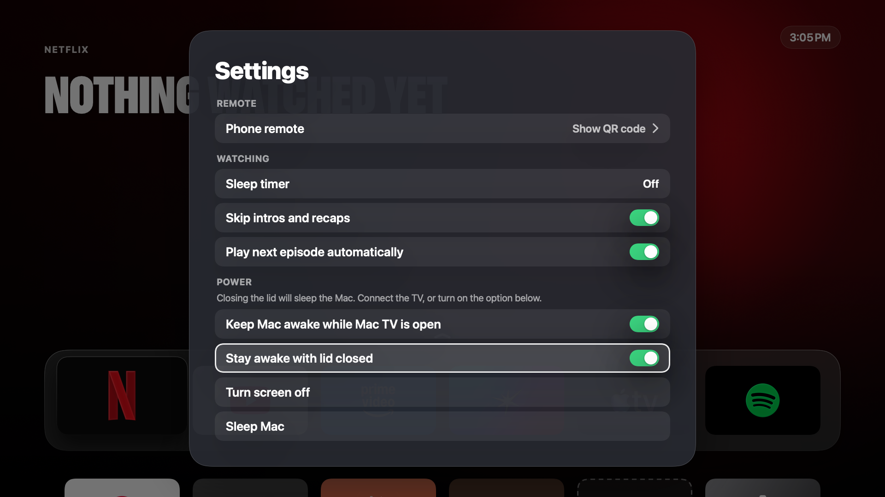
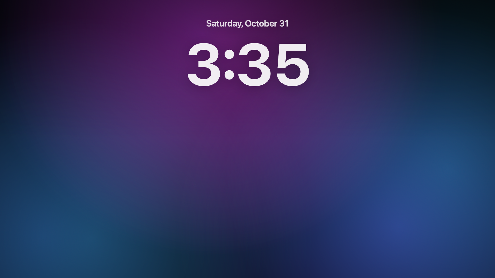
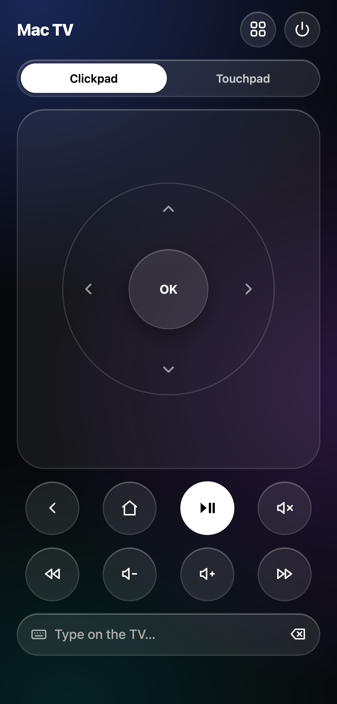
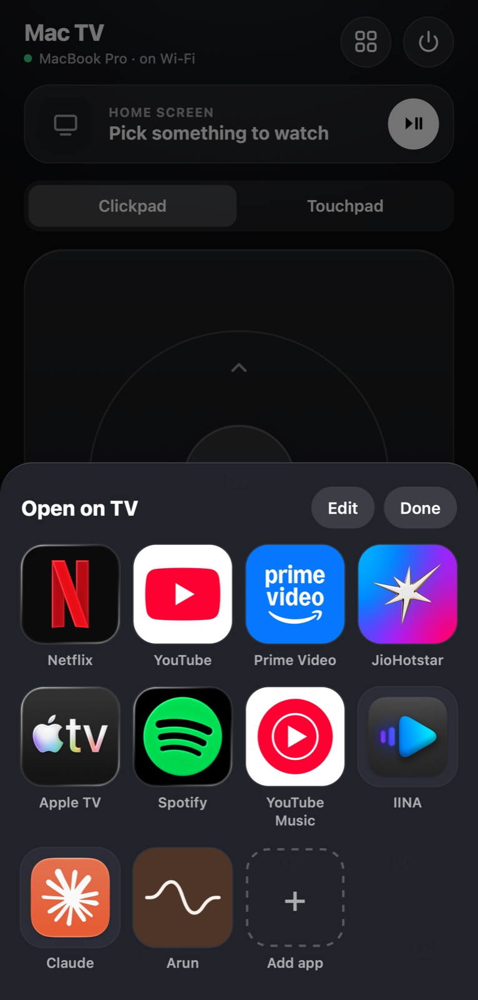
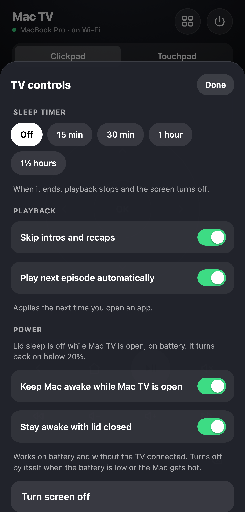

<h1 align="center">Mac TV</h1>

Turn a Mac into an Apple TV-style box: a tvOS-style home screen, your streaming apps in their official web players, and your phone as the remote.

## Screenshots

| Top Shelf | App grid |
|---|---|
|  |  |
| **Settings** | **Screensaver** |
|  |  |

| Phone remote | Apps | TV controls |
|---|---|---|
|  |  |  |

## Install

1. Download `MacTV-<version>.dmg` from [Releases](../../releases), open it, and drag **Mac TV** to Applications.
2. The first time you open it, macOS says it can't check the app, because it isn't notarized by Apple. Open **System Settings › Privacy & Security**, scroll down and click **Open Anyway**.
3. When macOS asks whether Mac TV may accept incoming network connections, choose **Allow**, so your phone can reach the remote.
4. A short setup follows: choose your apps, scan a QR code to use your phone as the remote, and you're done.

Requires macOS 14 or later, on an Apple silicon or Intel Mac.

## What it does

- **Apple TV's home screen:** a Top Shelf of the latest shows on each app, a dock of app tiles and the full grid below, in Liquid Glass.
- **Your streaming apps:** Netflix, YouTube, Prime Video, JioHotstar, Apple TV, Spotify and YouTube Music in their official web players, with DRM. Add any website, Mac app or Steam game as a tile.
- **Phone remote:** scan a QR code, no app to install. Clickpad, touchpad, typing, volume and haptics; wake the screen, choose the display, or open a website. Works away from home over Tailscale.
- **Game controllers:** PlayStation, Xbox, Switch Pro and other controllers drive it like an Apple TV controller.
- **Movies:** plays your own video files, including MKV, with subtitles and Continue Watching. Browse them from your phone.
- **Watching:** skips intros and recaps, plays the next episode, and has a sleep timer.
- **Screen saver:** Apple's live aerial wallpapers, show art, your photos, or drifting colour, with a clock.
- **Profiles:** each person gets their own apps and sign-ins.
- **Power:** keeps the Mac awake for the remote, and can stay awake with the lid closed.
- **Brave (optional):** open websites in Brave instead of the built-in player, with Brave's sign-ins and Shields.

## Privacy

Mac TV has no account and no servers of its own, and never records what you watch. It asks once whether to share anonymous usage (which features you use) through [TelemetryDeck](https://telemetrydeck.com), and sends nothing unless you say yes. Every event is in [`Analytics.swift`](Sources/MacTV/Analytics.swift). Details: [privacy policy](https://arunprakaash.github.io/mac-tv/privacy.html).

## Contributing

Building from source, tests and pull requests: see [CONTRIBUTING.md](CONTRIBUTING.md). Security problems: see [SECURITY.md](SECURITY.md).

## Who makes it

Mac TV is made by Arunprakaash ([LinkedIn](https://www.linkedin.com/in/Arunprakaash)). Questions and bug reports go to [GitHub issues](https://github.com/Arunprakaash/mac-tv/issues).

## License

MIT. See [LICENSE](LICENSE). "Mac" is an Apple trademark. This is a personal project, not affiliated with Apple, Netflix, Google, Amazon, JioStar, Spotify or Brave. App icons and service names belong to their owners and aren't covered by the license.
