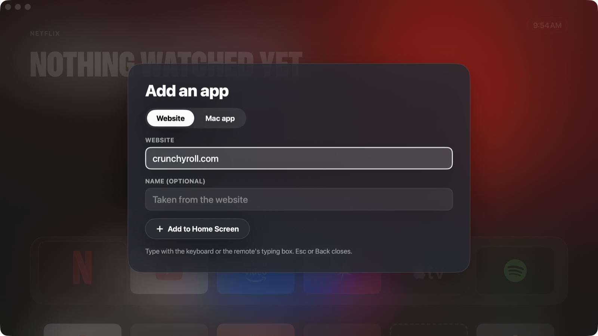

<p align="center"></p>

<h1 align="center">Mac TV</h1>

<p align="center">Turn a Mac into an Apple TV-style box: a tvOS-style home screen, your streaming apps in their official web players, and your phone as the remote.</p>


## Screenshots

| Top Shelf | App grid |
|---|---|
|  |  |
| **Settings** | **Screensaver** |
|  |  |

| Phone remote | Apps | TV controls |
|---|---|---|
|  |  |  |

## Install

1. Download `MacTV-<version>.dmg` from [Releases](../../releases), open it, and drag **Mac TV** to Applications.
2. The first time you open it, macOS says it can't check the app, because it isn't notarized by Apple. Open **System Settings › Privacy & Security**, scroll down and click **Open Anyway**.
3. When macOS asks whether Mac TV may accept incoming network connections, choose **Allow**. Without it, phones can't reach the remote.
4. A short setup follows: choose your apps, scan a QR code to use your phone as the remote, and you're done.

Requires macOS 14 or later, on an Apple silicon or Intel Mac. One download runs on both.

## How it works

Mac TV is a native Mac app. Each streaming service runs in its official web player inside Apple's Safari engine (WebKit), with WebKit's DRM capabilities. Actual quality depends on the service, Mac, subscription, display and connection; the Playback check screen reports capabilities without claiming a verified resolution. It isn't Android TV and doesn't emulate anything.

- **Home screen:** Apple TV's layout. A Top Shelf fills the screen behind a frosted glass dock of app tiles, with the next row peeking below. The Top Shelf shows the focused app in its own colours; move up for Open, and down for the full app grid. Sheets, buttons, pills and the volume indicator use Apple's Liquid Glass, and motion uses Apple's system springs. With Reduce Motion on, things fade instead of moving. It fills any screen shape edge to edge.
- **Window:** opens as a normal window on your external display and remembers its place. Use the green button or ⌃⌘F for full screen.
- **Keyboard and trackpad:** arrows, Return and Escape. Scroll to move between the dock and the grid. ⌘⇧H goes home.
- **Websites built for a mouse:** a focus ring slides between links and buttons, so the D-pad works everywhere.

## Phone remote

Open **Settings** on the TV, choose **Phone remote** and scan the QR code with your phone's camera. No app to install: it's a web page the Mac serves to your phone. Add it to your home screen to keep it one tap away.

- **Clickpad:** swipe anywhere, or tap an arrow on the ring; hold to repeat; tap the middle for OK.
- **Touchpad:** drag the pointer, tap to click, two fingers to scroll.
- **Keys:** media keys, volume, and typing on the TV.
- **Haptics:** light haptic feedback on every press.
- **Tailscale:** the Tailscale QR code works away from home, or when your Wi-Fi keeps devices apart.

## Game controllers

Pair a PlayStation, Xbox, Switch Pro or other MFi controller with the Mac in System Settings › Bluetooth, and it drives Mac TV like an Apple TV controller: the D-pad or left stick moves, A (✕) opens, B (○) goes back, Menu goes home, X plays or pauses, and the shoulder buttons skip. A banner shows when it connects, the home screen shows its own button symbols, and Settings shows its battery. Any number of controllers can be connected. While a Steam game is in front, the controller belongs to the game.

## Watching

- **Skip intros and recaps, play next episode:** Mac TV presses the players' own Skip Intro, Skip Recap and Next Episode buttons. It never presses an ad's "Skip" button. Turn these off in **Settings** on the TV or **TV controls** on the remote.
- **Sleep timer:** 15, 30, 60 or 90 minutes. When it ends, playback stops, Mac TV goes home and the screen turns off.
- **Screensaver:** after a few idle minutes (2 to 30, your choice), a lock-screen-style clock appears over the wallpaper you pick in **Settings › Screen Saver**: Apple's live wallpapers (the same aerials as System Settings › Wallpaper, shuffled or by category: Landscapes, Cities, Underwater, Space and more; downloaded ones play from the Mac, the rest stream from Apple), the Top Shelf's show art, a folder of your photos, or drifting colour. The clock can be turned off.
- **Top Shelf:** each streaming app's Top Shelf rotates through artwork from the latest shows on that app, like Apple TV: series with new episodes in the past two weeks, most popular first. That includes YouTube. Spotify and YouTube Music show this week's most-played albums, the cover over its own colours. Any other app you put in the top row (a website, a Mac app, a game) rotates through the top shows from every app. Mac TV refreshes the lists once a day from [TVmaze](https://www.tvmaze.com) (CC BY-SA) and Apple's public music charts. Art with writing in a script other than Latin is skipped; that check runs on your Mac.
- **Movies:** plays the video files in your Movies folder, and any other folders or drives you turn on. MKV files with H.264 or HEVC video and AAC, Dolby Digital, Dolby Digital Plus, Opus or MP3 audio play in Mac TV's own player using macOS's decoders, with nothing converted; so do MP4, MOV and M4V. The player has Apple TV's controls in Liquid Glass: left and right skip 10 seconds, select plays or pauses, down opens subtitles and audio, and they all work with the mouse too. Subtitles inside the file and `.srt` files next to it both work. Movies you've started appear in Continue Watching, with Resume or Start from the Beginning. Posters come from Apple's movie catalogue when the title matches exactly, otherwise from a frame of the film. Anything else (AVI, 10-bit H.264, VP9) opens in IINA or VLC if you have one.
- **Privacy:** Mac TV doesn't keep a list of what you watch in streaming apps, and the home screen never shows one. The Movies app remembers where you stopped in your own files, on your Mac, for Continue Watching.

## Power and the lid

- **Keep Mac awake:** while Mac TV is open, the Mac doesn't go to sleep on its own, so the phone remote always reaches it. The screen can still turn off. On by default; switch it in **Settings** on the TV or **TV controls** on the remote.
- **Closing the lid:** on power with the TV connected, macOS keeps the Mac running with the lid closed (Apple's closed-display mode). **Settings** and **TV controls** say whether closing the lid right now would sleep the Mac.
- **Stay awake with lid closed:** an option in **Settings** and **TV controls** for battery, or without the TV connected, like playing music with the lid shut. No admin password needed. "Lid sleep off" shows on the home screen while it's on. It turns off by itself when the battery drops below 20% or the Mac gets hot, and when Mac TV quits, even if it crashes. A closed Mac that stays awake runs warm, so don't put it in a bag.

## Your apps

The built-in apps are Netflix, YouTube, Prime Video, JioHotstar, Apple TV, Spotify, YouTube Music and IINA (if it's installed).

Choose **Add App** at the end of the home screen, or open **Apps** on the phone remote:
- **Website:** type an address. Mac TV finds the app's official icon itself and turns it into a tile that matches the rest.
- **Mac app:** pick any app installed on the Mac.
- **Steam:** pick Steam Big Picture or any installed Steam game. Games open through Steam, so DRM and cloud saves work, and Mac TV comes back to the front when you quit the game. Each game's tile is made from its Steam artwork.
- **Edit** (phone remote): pins favourites, changes app order, or removes apps. Removed built-in apps can be restored.

### Favourites and app order

Pin your favourites to keep them first on the home screen and phone remote. The first six apps
appear in the home-screen dock; additional favourites continue in the grid. Apps can be moved
earlier or later within their favourite or non-favourite group. Add App and Settings stay at the end.

- **On the TV:** open **Settings › Apps › Arrange Apps**. Up and down select an app; left and right choose
  Pin/Unpin, Move earlier or Move later; press OK to apply. Back returns to Settings. The keyboard,
  game controller and phone's D-pad all work.
- **On your phone:** open **Apps › Edit**, then use each app's pin and movement buttons. Tap Finish
  to return to launching apps.

Changes save automatically on the Mac and survive restarts. Existing apps and sign-ins are preserved.

On the TV, type with the keyboard or the remote's keyboard, and move between fields with the arrows.



Tiles are generated automatically from any square app icon (`TileArt.swift`). Mac TV reads the icon's background, finds the logo, sizes it to a standard visual weight, and extends the background to the 5:3 tile.

## Build from source

```bash
./build.sh                  # builds "build/Mac TV.app"
open "build/Mac TV.app"
./scripts/make-dmg.sh       # builds build/MacTV-<version>.dmg
./scripts/make-signing-cert.sh   # once: a local signing certificate, so macOS keeps permissions across builds
swift scripts/make-icon.swift   # redraws Assets/AppIcon.png and .icns
```

These checks run on their own and don't need the app open, unless noted:
- `swift test --disable-xctest` checks saved app-list migration, favourites, ordering and fixed utility tiles (requires Swift 6 or newer).
- `MacTV --selftest-drm` prints the DRM systems available.
- `--export-tiles <folder>` renders the dock tiles, `--export-home <folder>` the home screen, and `--export-remote <file.png> [apps|controls]` the phone remote. The remote export needs Mac TV running and `MACTV_REMOTE_CODE` set to its current displayed pairing PIN.

Some Swift 6.4 Command Line Tools installations have a [TestingMacros loading issue](https://github.com/swiftlang/swift-build/issues/1870).
If the test command reports that plugin missing, load it explicitly:

```bash
swift test --disable-xctest -Xswiftc -load-plugin-library \
  -Xswiftc "$(xcode-select -p)/usr/lib/swift/host/plugins/testing/libTestingMacros.dylib"
```

Sign-ins and added apps are kept in `~/Library/Application Support/Mac TV`.

## Who makes it

Mac TV is made by Arunprakaash ([LinkedIn](https://www.linkedin.com/in/Arunprakaash)). Questions and bug reports go to [GitHub issues](https://github.com/Arunprakaash/mac-tv/issues); security problems, see [SECURITY.md](SECURITY.md).

## License

MIT. See [LICENSE](LICENSE). App icons and service names belong to their owners and aren't covered by it.

## Notes

- "Mac" is an Apple trademark. This is a personal project, not affiliated with Apple, Netflix, Google, Amazon, JioStar or Spotify. App icons belong to their owners.

## TV setup, discovery and recovery

- **Settings › Dedicated TV mode:** choose a preferred display and start fullscreen. Display changes
  trigger recovery to the preferred display when available. **Exit TV mode** restores a normal window.
- **Launch at login** is optional and may require approval in macOS Login Items settings.
- **Settings › Apps › Top Shelf:** choose a household country and languages. Featured titles include
  service search actions where a search route is known. A title in the feed does not establish local availability.
- Streaming load failures offer **Retry**, **Open in Safari**, and **Home**, using the D-pad or mouse.
- **Settings › Watching › Playback check:** inspect WebKit DRM capabilities and display configuration. Actual
  playback resolution, HDR and HDCP remain unverified by this diagnostic.

## Paired phones

The TV shows a pairing PIN that refreshes every five minutes. Scanning its QR code exchanges the PIN
for an individual device credential. Name each phone when pairing, or choose guest access (24 hours).
The phone's **TV controls › Paired devices** screen can revoke one device or all devices. Guests
cannot manage paired devices. Credentials are stored as hashes on the Mac. The built-in LAN remote
uses HTTP; use a trusted network or the existing Tailscale option, and do not expose its port publicly.
Legacy phone codes may migrate during the first five minutes after upgrading; otherwise scan the new QR code.

## Release verification

Pull requests run Swift tests and build the universal app in GitHub Actions. This local branch's
workflow has not run on GitHub until it is pushed.

`./scripts/notarize.sh` builds, signs, notarizes and staples an app and installer using
`MACTV_DEVELOPER_ID` (Developer ID Application identity) and `MACTV_NOTARY_PROFILE` (an existing
notarytool Keychain profile). It requires the publisher's Apple Developer credentials. Ad-hoc local
builds are not notarized. The script never uploads a release to GitHub.

For isolated UI checks, `MACTV_DATA_DIR` can point at an absolute test data directory.

For a checkout on a cloud-synchronised drive, set `MACTV_BUILD_DIR` to an established local scratch
directory to keep the compiler's SQLite build database off the cloud drive. The finished app still
appears in the checkout's `build` folder.

## Files from your iPhone and subtitle fallback

Open **Apps › Files on Mac** on the paired phone. Browse Home, Downloads, Movies, Desktop,
external drives or selected library folders; filter the displayed filenames, then choose a video.
Use **Play on Mac TV** for the built-in player or **Play in IINA** for IINA. Only video and subtitle
files are shown alongside folders. File browsing does not require a keyboard on the Mac. macOS
may ask for access to a protected folder. Guest remotes cannot use the file browser.

For a selected movie, the phone can request IINA's online subtitle search, pick a local subtitle
file, or open a subtitle website on the phone. If online lookup fails, download a UTF-8 `.srt`
on the phone and upload it (up to 256 KiB). It is saved in Mac TV's own application data folder;
applying it opens the movie in IINA. Loading an external subtitle may reopen the video; verify
its playback position. IINA search and external-app control require macOS Accessibility permission.
Provider login, subtitle availability, and successful downloads remain IINA/provider-dependent.

ITVX and Channel 4 are included as website tiles. Use **Add App › Website** for other sites,
such as netmirror.app. The remote can target an HTML video inside a visible embedded frame,
but provider restrictions, sign-in, protected players and site compatibility still apply.
